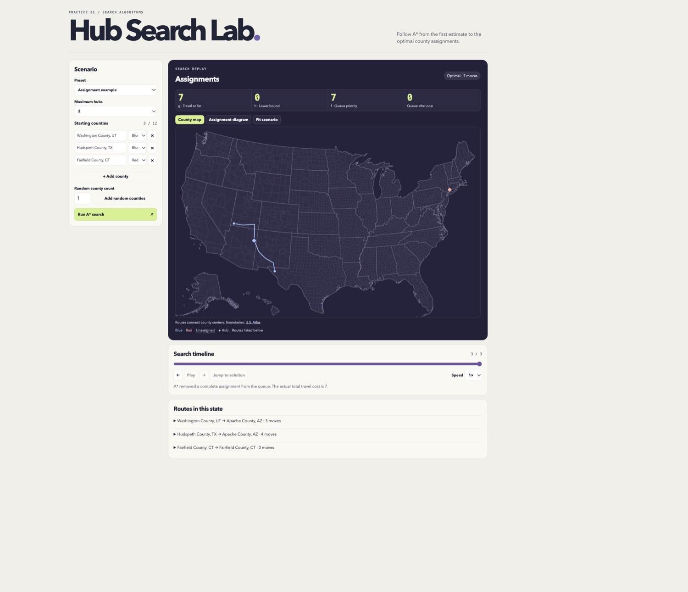
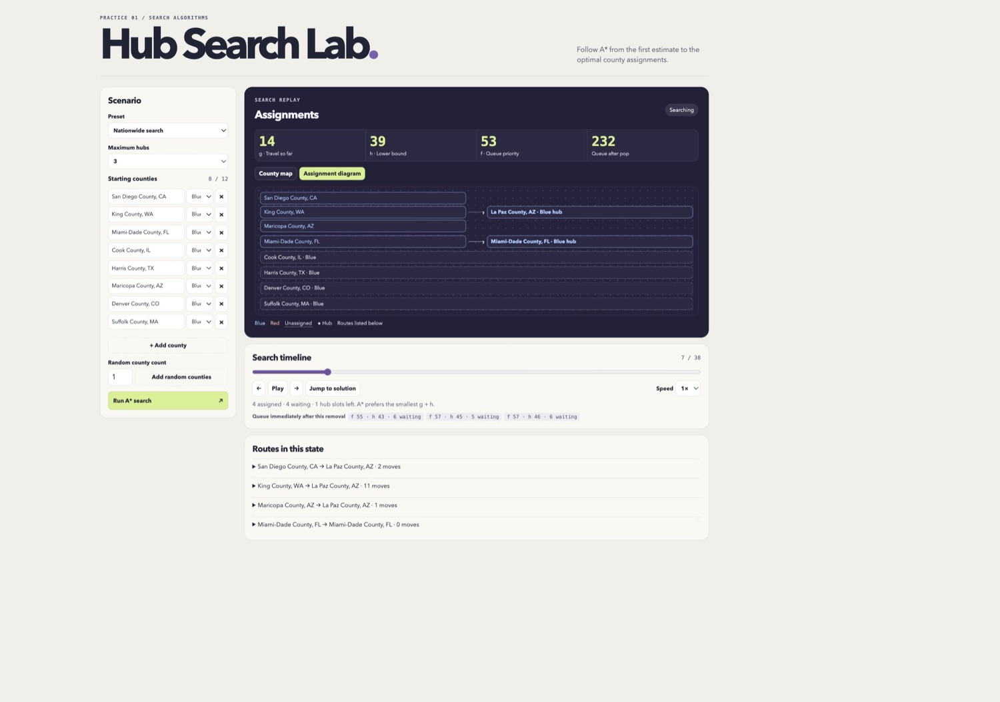

# Practice 1 · Hub Search Lab

## The assignment

**From Sea to Shining Sea** models campaign hub placement as a search problem. The input is an ordered list of starting counties, their parties, and a hub budget. The solver chooses hub locations and assigns each start to a reachable hub of the same party. A route may pass through counties of any party, and each county-to-county move costs one. The objective is to minimize the sum of the route lengths.

The handout specifies up to **10 starting locations and 5 hubs**. The interactive lab supports up to **12 locations and 12 hub slots** for experimentation. Both interpret the supplied hub count as an upper limit.



## Run the visualizer

From this `Practice_1` folder, use Python 3.

```bash
python3 search_visualizer/server.py
```

Open [Hub Search Lab](http://127.0.0.1:8765). The server and solver use Python’s standard library. The county boundaries load from [U.S. Atlas](https://github.com/topojson/us-atlas) over the internet. The assignment diagram and route list are available offline.

1. Choose **Assignment example**, **Nationwide search**, or **One slot, two parties**, or edit the scenario yourself.
2. Use **Add county** for a single entry. To append several unused counties, enter a **Random county count** and select **Add random counties**. Random entries default to Blue and can be edited individually.
3. Choose **Maximum hubs**, then select **Run A\* search**.
4. Use **Play**, the slider, the step buttons, or **Jump to solution**. Switch between **County map** and **Assignment diagram**. **Fit scenario** zooms to the counties in the current frame. Expand a route to see its full county sequence.

Map lines connect county centers along the solver’s graph routes. Diamonds mark hubs, and hollow circles mark unassigned starts.

## Read the replay



| Metric | Meaning |
| --- | --- |
| `g` | Total travel cost for groups assigned so far |
| `h` | Lower bound on the remaining travel cost |
| `f = g + h` | Priority used to choose the next state |
| Queue after pop | Entries left immediately after removing the current state, before expanding it |

Each frame records one priority-queue removal. Partial assignments may change between consecutive frames as A* explores different branches. A complete assignment has `h = 0`, so its `g` is the total cost.

### Worked example

| Starting county | Party | Assigned hub with two slots | Moves |
| --- | --- | --- | ---: |
| Washington County, UT | Blue | Apache County, AZ | 3 |
| Hudspeth County, TX | Blue | Apache County, AZ | 4 |
| Fairfield County, CT | Red | Fairfield County, CT | 0 |
| **Total** | | | **7** |

The two Blue counties are seven graph moves apart. Any shared hub requires at least seven total moves by the triangle inequality, and Apache County reaches that bound. With three slots, each start can host its own hub and the optimal cost is zero. With one slot, no complete assignment exists because the starts belong to two parties.

## How the solver works

1. **Build the county graph.** Each CSV row identifies two adjacent counties. The graph is undirected, and the loader discards self-loops.
2. **Compute shortest paths.** Breadth-first search from each distinct start gives the distance to every reachable county and the predecessors needed to reconstruct each route.
3. **Score candidate groups.** For a group of reachable same-party starts, choose the hub county that minimizes the sum of their distances. Equal-cost hub candidates are ordered alphabetically.
4. **Search over groupings.** A state contains the set of unassigned input indices and the number of hub slots left. An action anchors a new group at the first unassigned index, chooses its same-party partners, and spends one slot. This covers the possible partitions without enumerating group orderings.
5. **Stop at a complete assignment.** A* removes states in order of `f = g + h`. With the consistent heuristic below, the first complete assignment removed from the queue has optimal cost.

### Heuristic

The solver uses the greater of two lower bounds.

| Bound | Calculation |
| --- | --- |
| Counting | Count the distinct remaining county-party pairs, subtract the remaining hub slots, and floor the result at zero. Each pair beyond the budget must travel at least one move. |
| Minimum spanning forest | Connect remaining same-party, mutually reachable starts with edges weighted by shortest-path distance. Use Kruskal’s algorithm to find the lightest spanning forest that fits the hub budget. Divide its weight by two and round up. |

A round trip from a hub to each group member and back costs twice the group’s travel cost. The shortest distances between successive members yield a spanning tree of weight at most that round-trip cost. Applying this construction to all remaining groups gives the forest lower bound. Both bounds are admissible and consistent. The [written answers](hub_search/answers.pdf) prove these properties and give a counterexample showing that an admissible heuristic can violate consistency.

On the eight-location nationwide preset with three hubs, the combined heuristic reduced queue removals from **134 to 38** compared with the counting bound alone. Both runs found an optimal cost of **72 moves**. The write-up includes the comparison on three scenarios.

## Call the solver directly

From the `Practice_1` folder:

```bash
python3 -i hub_search/q1.py
```

At the Python prompt:

```python
locations = [
    ("Washington County, UT", "Blue"),
    ("Hudspeth County, TX", "Blue"),
    ("Fairfield County, CT", "Red"),
]
find_hub(locations, hub_number=2, search_method=1, detail_output=True)
```

Use county names as written in [adjacency.csv](adjacency.csv). Search method `1` runs A*. The function prints chosen hubs, assignments in input order, total cost, and each shortest route with its cost. Detailed output also prints the heuristic at the final state. If full coverage is infeasible, the function prints `No hub assigned` for every entry and a cost of zero for the empty set of routes. The visualizer labels that outcome **Infeasible**.

## Files

| File | Contents |
| --- | --- |
| [Exercise handout](ex%201.pdf) | Problem statement and submission requirements |
| [adjacency.csv](adjacency.csv) | County adjacency graph |
| [q1.py](hub_search/q1.py) | A* solver and assignment entry point |
| [answers.pdf](hub_search/answers.pdf) | Heuristic design, proofs, and benchmark results |
| [search_visualizer](search_visualizer) | Local server, replay interface, and screenshots |
