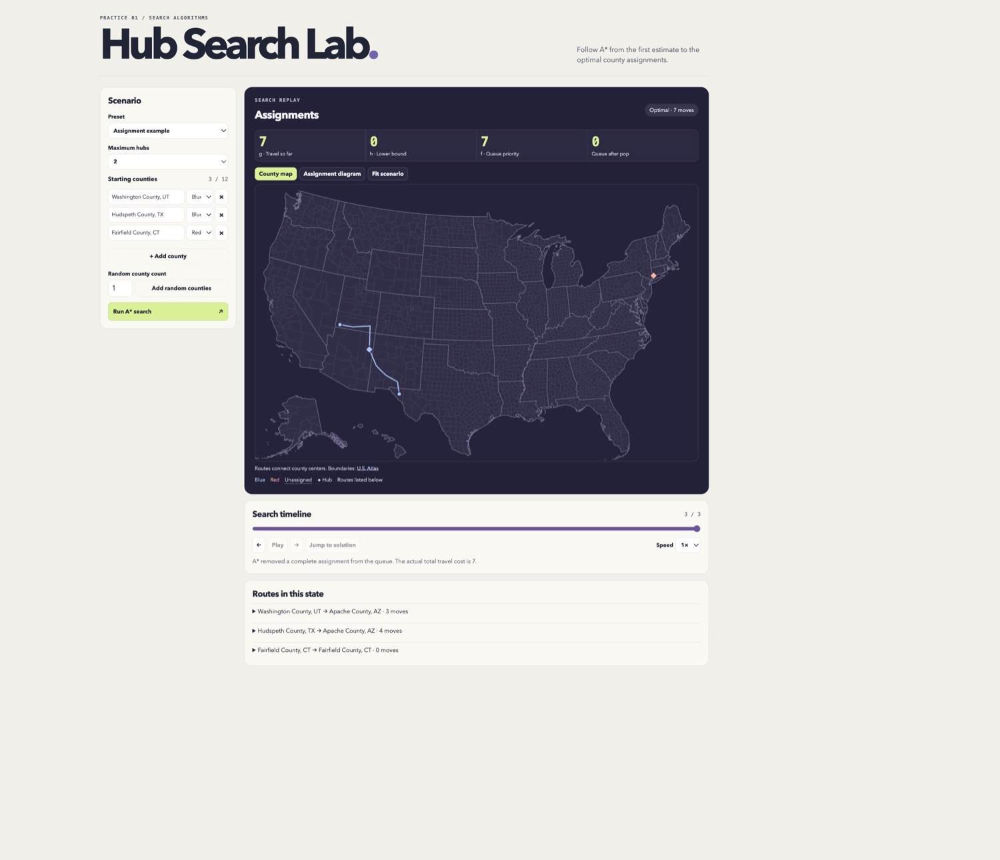
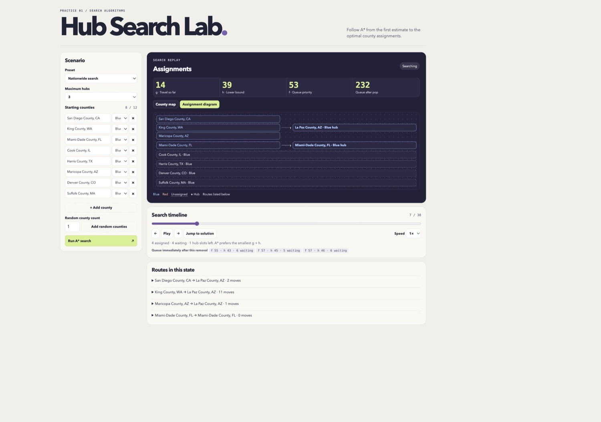

# Artificial Intelligence Practices

## Practice 1 · Hub Search Lab

Watch A\* choose campaign hubs across a graph of U.S. counties. Give each starting county a party, set the maximum number of hubs, then replay the search as the solver builds assignments and minimizes county-to-county moves.



### Run it locally

Use Python 3 from the repository root.

```bash
python3 Practice_1/search_visualizer/server.py
```

Open [Hub Search Lab](http://127.0.0.1:8765). The server and solver use Python’s standard library. The map loads boundaries from [U.S. Atlas](https://github.com/topojson/us-atlas) over the internet. The assignment diagram and route list are available offline.

1. Pick a preset or set your own scenario with up to **12 starting counties and 12 hub slots**.
2. Enter a number under **Random county count** and select **Add random counties** to append that many unused counties. New entries start as Blue and can be changed individually.
3. Select **Run A\* search**, then play, scrub, or step through the search. Try **Nationwide search** for a longer replay.
4. Switch between the **County map** and **Assignment diagram**. Use **Fit scenario** to zoom in, or expand a route to see every county along its path.

### Read the replay



| Metric | Meaning |
| --- | --- |
| `g` | Travel cost of the assignments made in this state |
| `h` | Lower bound on the remaining travel cost |
| `f = g + h` | Priority used to choose the next state |
| Queue after pop | Number of entries left immediately after the current state was removed |

Each replay frame is a queue removal. Partial assignments can change between frames as A\* explores different branches. The solver assigns groups to same-party hubs. Breadth-first search provides the shortest routes, and each move across a county boundary costs one. Map lines connect county centers along those routes.

In the assignment preset, two hub slots yield a minimum cost of **7 moves**. The two Blue starts share Apache County, AZ, and Fairfield County, CT hosts its own Red hub. With three slots, every start can host its own hub and the cost drops to zero.

### Practice files

| File | Contents |
| --- | --- |
| [Exercise handout](Practice_1/ex%201.pdf) | Problem statement and submission requirements |
| [adjacency.csv](Practice_1/adjacency.csv) | County adjacency graph |
| [q1.py](Practice_1/hub_search/q1.py) | A\* solver and assignment entry point |
| [answers.pdf](Practice_1/hub_search/answers.pdf) | Heuristic design, proofs, and benchmark results |
| [search_visualizer](Practice_1/search_visualizer) | Local server and browser replay interface |
