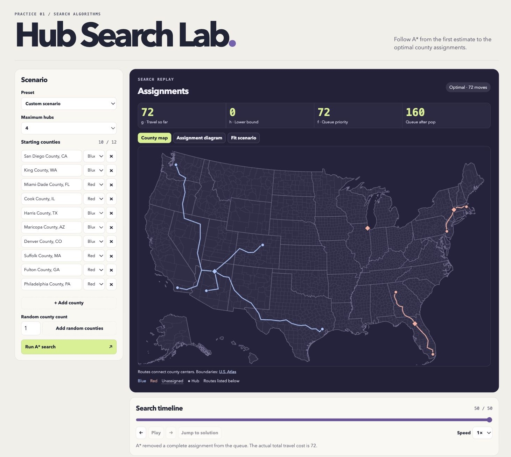

# Artificial Intelligence Practices

Course exercises in artificial intelligence, with implementations, written explanations, and interactive experiments. Each practice folder has its own guide, source files, and supporting material.

## Practices

| Practice | Topic | What you can explore |
| --- | --- | --- |
| [Practice 1 · Hub Search Lab](Practice_1/README.md) | A* search, shortest paths, and heuristic design | Place campaign hubs on a U.S. county graph, then replay the search state by state |

## Practice 1 at a glance

Give each starting county a party and set a hub budget. The solver finds same-party assignments that minimize the total number of county-to-county moves. In the example below, **four hubs serve ten starts in 72 moves** after 50 priority-queue removals.

[Open the full practice guide](Practice_1/README.md) for setup instructions, a walkthrough of the solver and heuristics, and a longer replay.
